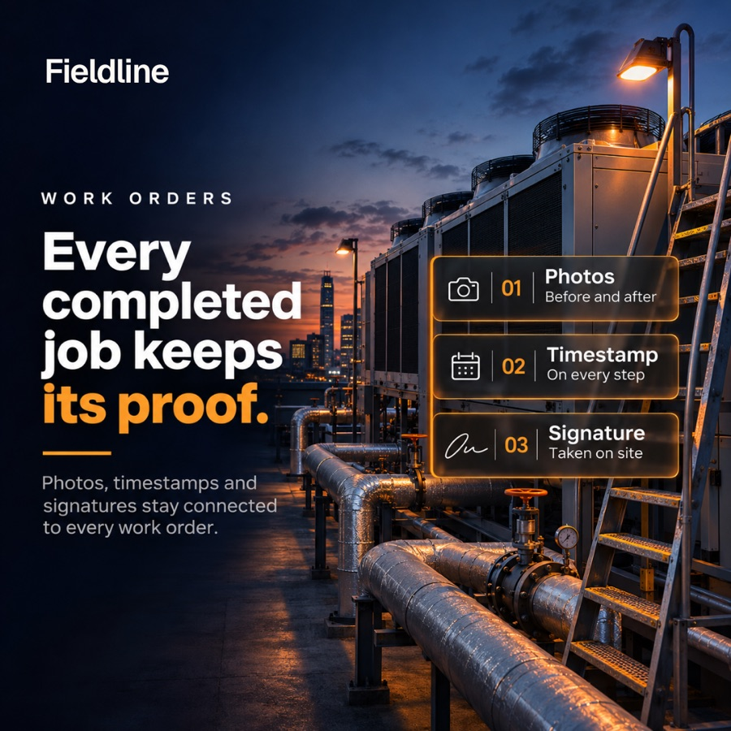
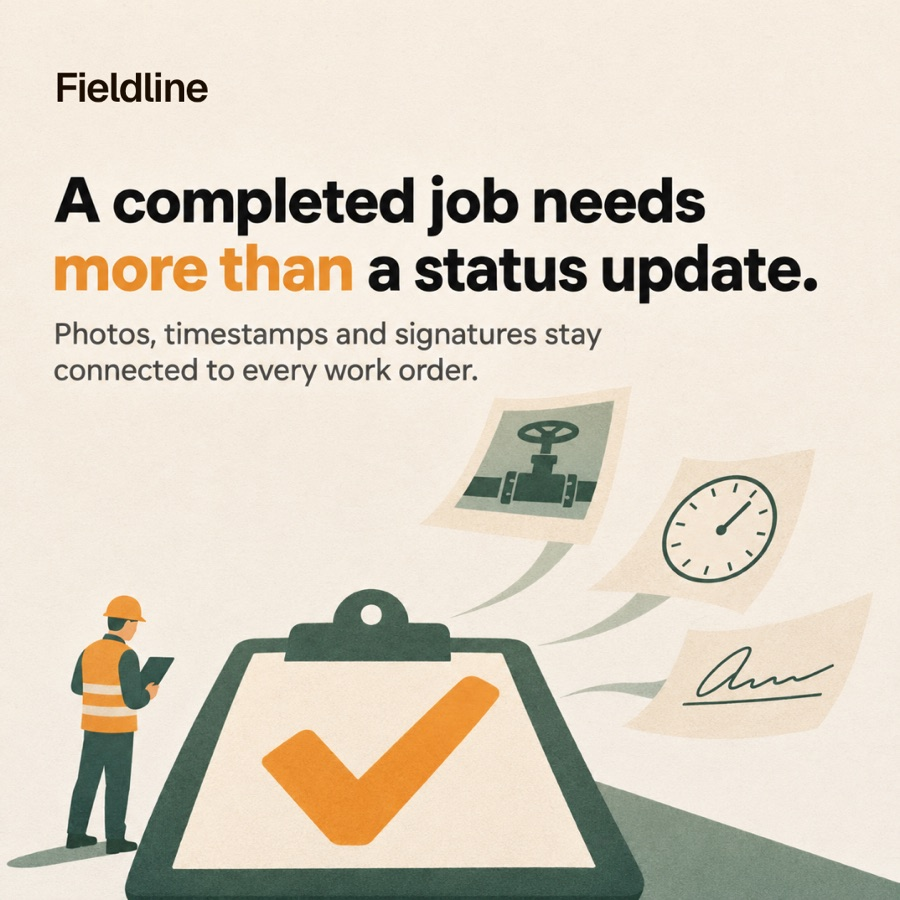

<p align="center"></p>

<p align="center"><b>Write one sentence. Get a finished ad in your brand.</b><br>
For Claude Code, Codex and Cursor: a short request becomes a complete image, with your copy, your colours and your logo.</p>

<p align="center">
  
  
  
</p>

<p align="center"><sub>Three images from the same three sentences, for a demo brand. None was edited by hand.</sub></p>

## How it works

```
/mos:image Instagram post: a completed job needs more than a status update.
Photos, timestamps and signatures stay connected to every work order.
```

About two minutes later you have the image.

1. **Three ideas, one drawn.** A tension, a proof and a moment are weighed for your message. The strongest is drawn.
2. **One picture.** Scene and copy are drawn together, in your brand's colour and typeface.
3. **Every word read back.** The text in the picture is compared with your copy, word for word. A picture with a wrong word is drawn again.
4. **Your logo.** It is set on the image, and you get a link to the result.

## What you can ask for

| You type | You get |
|---|---|
| `/mos:brand:new https://yourshop.com` | Your brand, read from your site: name, colours, logo, tone, facts and products |
| `/mos:image LinkedIn post about our new night service` | One finished ad |
| `/mos:image three versions of ...` | Up to three, each from another idea and in another kind of picture |
| `/mos:image a 4-page swipe post about ...` | A carousel: one scene kept through every page, with a page counter |
| `/mos:ideas` | Four posts your competitors are not making; the one you pick is made |
| `/mos:text LinkedIn post about the new opening hours` | A post within the channel's limits |
| Short video <kbd>SOON</kbd> | One sentence in, a few seconds of motion in your brand out |

Plain words work too; the commands are shortcuts in Claude Code.

## What it holds to

- **Only your facts.** Prices, dates and figures come from what you, your site or your product page say. A missing fact gets one question, never an invention.
- **No two alike.** A brand's images turn through twelve kinds of picture. The hour, the camera's place and the materials change from one image to the next.
- **Plain copy.** Stock ad wording is refused before anything is drawn.
- **Your brand.** Colours, typeface, logo and tone come from your brand card.

## Kinds of picture

| Kind | What it shows |
|---|---|
| Proof scene | Your customer's real site in low light, with the message proved inside the picture: numbered rows, rising steps, a trail of light, a chart panel, a map or one large figure |
| Candid moment | One documentary photograph of the moment in which your message is true |
| Product at work | A screen with specific rows and linked cards on a dark ground |
| Interface in a real place | Your product's screen on the desk where your customer works |
| Before and after | The same place twice, side by side |
| Editorial illustration | One conceptual drawing, as a business magazine would print it |
| 3D metaphor | One studio-lit object that pictures the problem or its solution |
| Macro detail | An extreme close-up of one small real thing |
| Type and one figure | A figure you stated, set very large on paper, concrete or a grid |
| Quote as a cover | A customer's own sentence, set like a magazine cover |
| Question | A question to the reader, with two or three answers under it |
| Still life | The real objects of your customer's work, in daylight |

**Formats.** Instagram post (4:5) and square; LinkedIn, X and Facebook (square); YouTube thumbnail and presentation slide (16:9); story and TikTok (9:16).

**Around the copy.** A tag, a headline with one phrase in your colour, a subline, a proof line in your own figures, a button, a partner or event line and a signature line. A photo or a customer's logo you attach appears as it is.

## Install

**Claude Code**

```
npx --yes github:cantasci/mos
```

Then start a new session, run `/mcp`, choose **plugin:mos:marketing-os**, press **Authenticate** and enter your access code.

**Codex**

```
codex plugin marketplace add cantasci/mos
codex plugin add mos@marketing-os
```

**Cursor**

Add the server to `~/.cursor/mcp.json` (or to `.cursor/mcp.json` in a project) and sign in when Cursor asks:

```json
{ "mcpServers": { "marketing-os": { "url": "https://mos-mcp.up.railway.app/mcp" } } }
```

In Codex and Cursor, ask in plain words ("an Instagram post for our free first class").

<details>
<summary>Claude Code: install by hand, update, and sign-in problems</summary>

**By hand**

```
claude plugin marketplace add cantasci/mos
claude plugin install mos@marketing-os
```

**Update**

```
/plugin marketplace update marketing-os
```

**Check the state without changing anything**

```
npx --yes github:cantasci/mos --check
```

**"Couldn't start sign-in for marketing-os".** The server was also added by hand, and the second entry stops sign-in. Run `claude mcp remove marketing-os`, start a new session and authenticate **plugin:mos:marketing-os**. Install the plugin only; do not add the server yourself with `claude mcp add`.

**Commands are missing after an update.** Run the installer again and start a new session.

</details>

## Commands in Claude Code

| Command | What it does |
|---|---|
| `/mos:brand:new <link or description>` | Set up a brand from its site, or from a name and one sentence |
| `/mos:brands` | List your brands |
| `/mos:brand:select <name>` | Work on another brand |
| `/mos:image <what it is for>` | A finished ad; `/mos:image <job id>` fetches one later |
| `/mos:ideas <competitors, or nothing>` | Four post ideas from what your competitors are not doing |
| `/mos:text <channel and topic>` | A post or caption |
| `/mos:usage` | How much you have made today |
